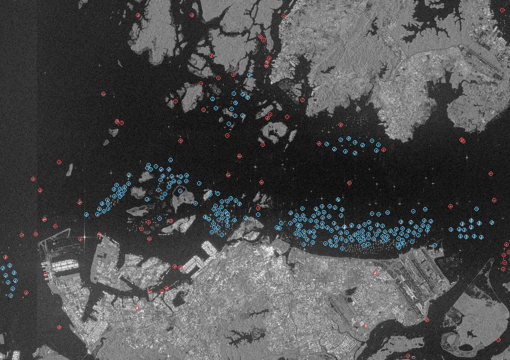
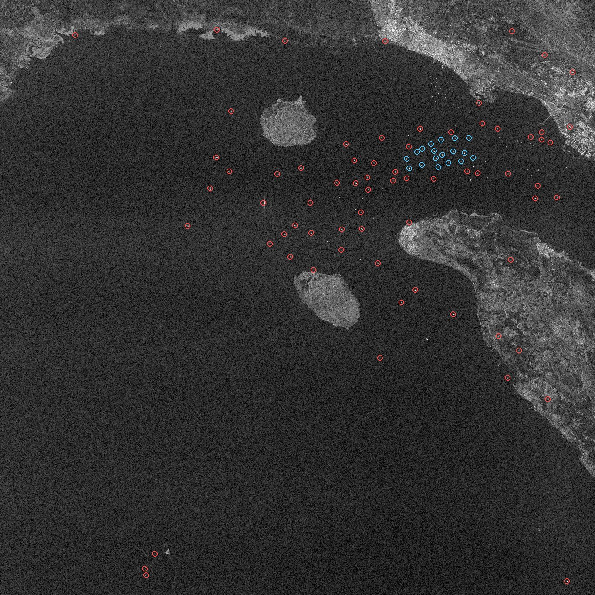
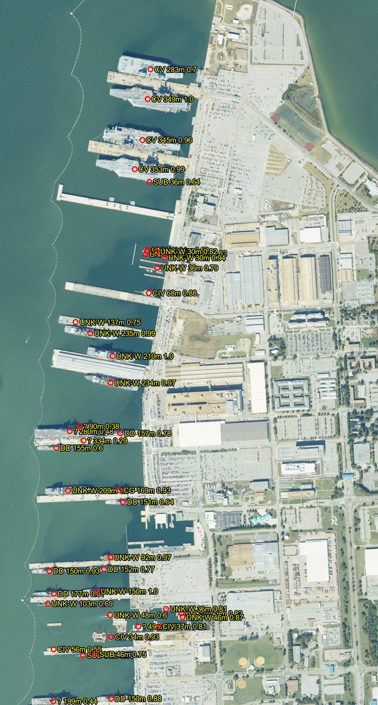

# Setup and reproduction guide

This guide takes you from an empty machine to every result this project has
produced: the demo, the fine-tuned ship detector, the warship-type classifier,
two real Sentinel-1 radar scans, and the Naval Station Norfolk scan where
aircraft carriers, destroyers and a cruiser are identified by type.

No accounts, API keys or GPU are needed. Everything is downloaded from public
sources.

**Contents**

1. [What you need](#1-what-you-need)
2. [Install](#2-install)
3. [Check the install](#3-check-the-install)
4. [Demo run](#4-demo-run-2-minutes)
5. [Train the ship detector](#5-train-the-ship-detector-about-2-hours)
6. [Scan real radar imagery](#6-scan-real-radar-imagery-5-minutes-per-scene)
7. [Train the warship classifier](#7-train-the-warship-classifier-about-15-hours)
8. [Identify warships on sharp imagery](#8-identify-warships-on-sharp-imagery-5-minutes)
9. [View everything in the dashboard](#9-view-everything-in-the-dashboard)
10. [Expected results at a glance](#10-expected-results-at-a-glance)
11. [Troubleshooting](#11-troubleshooting)

---

## 1. What you need

| | |
|---|---|
| Python | 3.10 or newer (developed on 3.11) |
| Git | any recent version |
| Disk | about 4 GB free (repository with training chips, datasets, weights, imagery) |
| Memory | 8 GB minimum, 16 GB comfortable |
| Internet | needed for the installs and downloads; about 400 MB in total beyond the clone |
| GPU | **not required** — all times below are for a 12-core laptop CPU |

Works on Windows, macOS and Linux. Commands are the same everywhere except
where a Windows variant is shown.

Time needed for everything: roughly **4 hours**, almost all of it unattended
training. Sections 4, 6 and 8 give results in minutes if you skip training —
see the note at the start of each.

---

## 2. Install

Clone the repository. It includes the 39,729 SAR-Ship training chips, so the
clone takes a few minutes.

```bash
git clone https://github.com/Jainish445/GeoVision.git
```

```bash
cd GeoVision
```

Create a virtual environment and activate it.

```bash
python -m venv .venv
```

macOS / Linux:

```bash
source .venv/bin/activate
```

Windows (PowerShell):

```bash
.venv\Scripts\Activate.ps1
```

Install the dependencies. This pulls in PyTorch, so expect several minutes.

```bash
pip install -r requirements.txt
```

All commands from here on are run from the repository root with the virtual
environment active.

---

## 3. Check the install

```bash
python -m pytest tests -q
```

Expected: `148 passed` in about a minute. The tests need no network, GPU or
model weights, so a pass here means the code and all libraries work.

---

## 4. Demo run (2 minutes)

The demo needs nothing downloaded or trained. It simulates three satellite
passes over seven ships, rendering a synthetic radar tile and a synthetic AIS
feed for each pass, and runs the real classifier, AIS fusion, tracker and
database on them.

```bash
python pipeline.py --demo
```

Expected last lines:

```
Pipeline complete — 21 detection(s)
"detections": 21, "tracks": 7
```

and in the log, one line per ship showing how its label came about:

| Ship | Label | Evidence |
|---|---|---|
| DEMO CARRIER | Aircraft Carrier | military AIS + hull size |
| DEMO DESTROYER | Destroyer | military AIS + hull size |
| DEMO AMPHIB | Amphibious Assault | military AIS + hull size |
| two ships with no AIS | Unidentified Vessel (frigate-sized, patrol-sized) | hull size only |
| DEMO TANKER, DEMO CARGO | Civilian Vessel | commercial AIS |

Open the dashboard to see them on the map (section 9).

---

## 5. Train the ship detector (about 2 hours)

The radar pipeline needs a YOLOv8 model fine-tuned on radar ship chips. The
stock model finds nothing in radar imagery, and trained weights are not stored
in the repository, so this step is required before section 6.

### 5.1 Split the dataset

```bash
python train/finetune.py prepare --raw-dir data/SAR-Ship-Dataset --output-dir data/dataset
```

This copies the chips into `data/dataset/` as 31,783 training and 7,946
validation images. It takes 5–40 minutes depending on the disk (slowest on
Windows with antivirus scanning).

### 5.2 Fine-tune

```bash
python train/finetune.py train --data data/dataset/data.yaml --imgsz 256 --fraction 0.3 --epochs 6 --batch 32 --workers 6 --device cpu
```

- The YOLOv8n starting weights (6 MB) download automatically on first use.
- `--imgsz 256` trains at the chips' native size, which matches the scale ships
  have in pipeline tiles. `--fraction 0.3` uses 30 % of the training images.
  Both exist to make CPU training practical.
- About 15 minutes per epoch, 90 minutes in total.

Expected final validation line (values vary slightly between machines):

```
all   7946   10079   0.765   0.733   0.79   0.324
```

That is precision 0.77, recall 0.73, mAP50 0.79. The best weights are copied
to `models/weights/warship_yolov8n.pt`, where the pipeline finds them
automatically.

**With a GPU** you can do much better: set the environment variable
`YOLO_MODEL_SIZE=yolov8m`, drop `--fraction` and `--imgsz`, use `--epochs 80
--device 0`. The pipeline then looks for `warship_yolov8m.pt`, so keep the
variable set when running it.

---

## 6. Scan real radar imagery (5 minutes per scene)

*Requires section 5.*

With no Copernicus account configured, the pipeline fetches Sentinel-1 radar
scenes from Microsoft's public Planetary Computer archive, downloading only
the window you ask for (at most about 80 × 80 km).

The `--date` option pins the run to the satellite pass used here, so you get
the same scene. Without it the newest pass in the last `--days` days is used.

### 6.1 Singapore Strait

```bash
python pipeline.py --bbox 1.05 103.60 1.35 104.10 --local-region Singapore_Strait --date 2026-09-27 --no-ais
```

The four numbers are `lat_min lon_min lat_max lon_max`.

Expected:

```
88 tile(s) generated.
Dropped 64 detection(s) outside 0–500 m (not ships).
306 detection(s) after NMS.
Classified 306 detection(s): Unidentified Vessel=306
Context: 234 unidentified ship(s) in crowded waters marked probable civilian.
```



*Blue: probable civilian (crowded anchorage). Red: unidentified. The image is
flipped north–south, as raw radar data from an ascending orbit is.*

### 6.2 Strait of Hormuz

```bash
python pipeline.py --bbox 26.5 56.0 27.2 56.8 --local-region Persian_Gulf --date 2026-10-03 --no-ais
```

Expected: 225 tiles, **88 detections**, 18 marked probable civilian, 70
unidentified.



### 6.3 What to expect from your own run

- **Counts will differ by a few percent.** Your detector was trained on your
  machine and will not be bit-identical to the one used here.
- **No warship types appear, by design.** A 10 m radar pixel shows only hull
  length and width, and merchant ships come in every size warships do. Each
  ship gets a *size class* (for example "Destroyer-sized") but stays
  "Unidentified Vessel" unless AIS identifies it. Section 8 is how real
  warship types are obtained.
- **Some detections are on land.** There is no land mask; a dozen or so
  coastline false alarms per scene is normal.
- **Any other area:** change the four `--bbox` numbers and drop `--date`.

---

## 7. Train the warship classifier (about 1.5 hours)

The classifier is a ResNet-50 that recognises ship types in sharp optical
imagery. It is trained on FGSC-23, a research dataset of 4,080 real ship
crops in 23 fine-grained classes. **FGSC-23 is for research use only** — see
its [dataset page](https://huggingface.co/datasets/jbourcier/fgsc23) for the
citation.

### 7.1 Download FGSC-23 (99 MB)

```bash
curl -L --create-dirs -o data/classifier_raw/FGSC-23.zip https://huggingface.co/datasets/jbourcier/fgsc23/resolve/main/FGSC-23.zip
```

On Windows PowerShell use `curl.exe` instead of `curl`.

```bash
python -m zipfile -e data/classifier_raw/FGSC-23.zip data/classifier_raw
```

### 7.2 Arrange it into class folders

```bash
python data/dataset.py prepare-fgsc --raw-dir data/classifier_raw --output-dir data/classifier
```

Expected: nine classes, 2,869 training and 727 test images. The 23 original
classes are mapped onto this project's classes; the mapping is
`FGSC23_CLASS_MAP` in `data/dataset.py`. Merchant ship types become
**Civilian Vessel**; auxiliaries, command ships and landing craft become
**Unknown Warship**; the "non-ship" class is dropped.

### 7.3 Train

```bash
python models/classifier.py train --data data/classifier/train --epochs 12 --batch 32
```

- The ImageNet starting weights (100 MB) download automatically.
- About 7 minutes per epoch on CPU. One fifth of the training folder is held
  out for validation; the test folder is not touched.
- Validation accuracy should climb from about 0.38 after epoch 1 to about 0.88.

Weights are saved to `models/weights/warship_classifier.pt`.

### 7.4 Measure accuracy on the untouched test set

```bash
python models/classifier.py eval --data data/classifier/test
```

Expected (within a point or two):

```
Overall accuracy:  0.889
Balanced accuracy: 0.890

Class                      n    acc   most confused with
Aircraft Carrier          34   0.91   Unknown Warship (2)
Destroyer                108   0.81   Cruiser (9)
Frigate                   59   0.92   Destroyer (3)
Cruiser                   59   0.81   Destroyer (6)
Submarine (surfaced)      48   0.90   Patrol / Corvette (2)
Amphibious Assault        67   0.94   Unknown Warship (3)
Patrol / Corvette         29   0.93   Unknown Warship (1)
Unknown Warship          119   0.85   Civilian Vessel (9)
Civilian Vessel          204   0.94   Unknown Warship (9)
```

The classifier is deliberately **not** used on Sentinel imagery: it only runs
when a tile is sharper than 4 m per pixel (`CLASSIFIER_CNN_MAX_GSD_M` in
`config.py`).

---

## 8. Identify warships on sharp imagery (5 minutes)

*Requires section 7. Does not require section 5.*

`--sensor NAIP` switches to high-resolution mode: free 0.6 m aerial imagery
of the United States, a ship detector trained on aerial photos, and the
classifier from section 7.

```bash
python pipeline.py --sensor NAIP --bbox 36.936 -76.345 36.966 -76.318 --local-region Norfolk_Naval_Station --date 2023-10-09 --no-ais
```

- The aerial-photo detector (YOLOv8l-OBB, 90 MB, official release) downloads
  automatically on first use.
- Detection runs at three zoom levels; expect about two minutes on CPU.

Expected:

```
23 tile(s) generated.
43 detection(s) after NMS.
Classified 43 detection(s): Aircraft Carrier=4, Civilian Vessel=4, Cruiser=1,
  Destroyer=7, Submarine (surfaced)=3, Unidentified Vessel=5, Unknown Warship=19
```



*Each label is type, hull length and classifier confidence. CV = aircraft
carrier, DD = destroyer, CG = cruiser, UNK-W = other naval or auxiliary,
CIV = civilian, ? = undecided.*

How to read this result:

- **All four aircraft carriers are found and typed correctly**, with
  confidence 0.70–1.00.
- **Seven destroyers** are reported at 150–177 m, most at 150–157 m, in line
  with the US Navy's roughly 155 m destroyers, and **one cruiser** at 169 m.
- These were checked by eye against the photo, not against a record of which
  ships were in port that day.
- **Known errors:** the three "submarines" are 36–48 m objects and almost
  certainly wrong; small craft and tugs get arbitrary labels because the
  classifier was never trained on them; the large amphibious ship is left
  undecided; ships moored hard against a pier can be boxed together.
- **Coverage:** this imagery exists for the United States only and each state
  is re-flown every two to three years. For another country, supply your own
  image of similar sharpness: `python pipeline.py --local-dir image.tif
  --sensor NAIP`.

---

## 9. View everything in the dashboard

```bash
streamlit run dashboard.py
```

It opens at http://localhost:8501.

- **Region of Interest** (sidebar): pick `South_China_Sea` for the demo,
  `Singapore_Strait`, `Persian_Gulf`, or `Norfolk_Naval_Station`.
- **Show last N days**: defaults to 30. The pinned radar passes in section 6
  are older than that by now, so raise the slider or use the next switch.
- **All dates**: turn this on to see the Norfolk scan, which is from 2023.
- **Detections tab**: one row per detection with its label, the evidence
  behind it (`type_source`), size class, and measured hull length and beam.
- Click any map marker for the same details.

---

## 10. Expected results at a glance

| Step | Result |
|---|---|
| Tests | 148 passed |
| Demo | 21 detections, 7 tracks; 3 warships typed from AIS, 2 unidentified, 2 civilian |
| Ship detector (YOLOv8n, 6 epochs, CPU) | mAP50 0.79, precision 0.77, recall 0.73 on 7,946 validation chips |
| Singapore Strait, 27 Sep 2026 | 306 ships: 234 probable civilian, 72 unidentified |
| Strait of Hormuz, 3 Oct 2026 | 88 ships: 18 probable civilian, 70 unidentified |
| Warship classifier (ResNet-50) | 88.9 % on 727 held-out test images |
| Naval Station Norfolk, 9 Oct 2023 | 43 vessels: 4 aircraft carriers, 7 destroyers, 1 cruiser typed |

Numbers that depend on a model you trained yourself (everything except the
tests and the demo) will be close to these but not identical.

---

## 11. Troubleshooting

**`Fine-tuned weights not found … using generic YOLOv8`, and zero detections**
Section 5 has not been run, or `YOLO_MODEL_SIZE` is set to a size you did not
train. The file `models/weights/warship_<size>.pt` must exist.

**`Classifier weights not found`**
Harmless for radar scans (the classifier is not used there). For section 8,
run section 7 first.

**`Planetary Computer signing failed — retrying`**
The archive's signing service times out now and then. The pipeline retries
four times; if it still fails, run the command again.

**`No products found`**
No satellite pass covered the box in the search window. Increase `--days`, or
check that the box is in `lat_min lon_min lat_max lon_max` order with west
longitudes negative.

**`No NAIP imagery here`**
NAIP covers the United States only.

**Training is very slow**
Close other heavy programs; training uses every CPU core. To shorten it,
lower `--fraction` (detector) or `--epochs`. Accuracy will drop accordingly.

**The dashboard shows only demo data**
Raise "Show last N days" or turn on "All dates" — the real scans are dated
when the satellite passed, not when you ran the pipeline.

**`Port 8501 is already in use`**
Another dashboard is running. Close it, or start a second one with
`streamlit run dashboard.py --server.port 8502`.

**Garbled symbols in the Windows console**
Cosmetic only. Use Windows Terminal, or ignore them; the log file
`results/pipeline.log` is always written correctly.

**Using a Copernicus account instead**
Optional. Set `COPERNICUS_USER` and `COPERNICUS_PASSWORD` and add `--source
copernicus`. This downloads whole products (about 1.7 GB each) rather than a
window, and is the only way to get Sentinel-2 optical imagery. This path has
not been exercised end to end in this project.

**Starting over**
Delete `results/warship_tracks.db` to clear all detections. Downloaded
imagery is in `data/raw/`, tiles in `data/tiles/`; both can be deleted and
will be recreated.

---

*Imagery credits: Sentinel-1 data © Copernicus / ESA, accessed through
Microsoft Planetary Computer. NAIP aerial imagery courtesy of the USDA Farm
Production and Conservation Business Center.*
